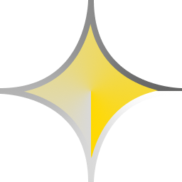

    <h1>Hello, GitHub!</h1>
    
    
    
    <table width="100%">
        <td align="left"></td>
        <td align="right"><h3><italic>"About space too many questions, but where are answers?"</italic></h3>
        
Меня зовут <strong>ntcd_lol</strong>, я русский начинающий разработчик которому всего 13 лет (2013 года).

        <blackquote>
Цитата дня: <strong>"Умерев морально, воскреснуть возможно, а сгнив физически - никто не вспомнит."</strong>
</blackquote>
        

        </td>
    </table>

## Мои Соцсети

- [Telegram](https://t.me/NTheCuteDrone)
- [Discord](https://discordapp.com/users/1315344658301452328)

## Мои проекты

### Готовые

+ [PSE SDK Lua](https://github.com/ntcd-lol/pse-lua) - Проект по переносу [PSE SDK (Made by RootTool0)](https://github.com/RootTool0/pse-sdk) с сырых пакетов в C++ на удобный Fluent API Lua. (v0.1)

### В разработке

+ N (nlang) - Гибкий язык программирования что смешивает лучшие черты характера Rust, C++ и Zig.

+ SolverCore - Движок игр на C++, SDL3 и Vulkan.

+ [myspace](https://github.com/ntcd-lol/myspace) - форк VSCodium, для удобного IDE оптимизированного под C++.

+ [PSE GUI](https://github.com/ntcd-lol/pse-gui) - Проект по облегчению создания уровней для Portal: Solver.

+ anix (ранее some) - Мессенджер со своими алгоритмами передачи данных.

+ [baddy754](https://github.com/ntcd-lol/baddy754) - проект простых заголовочных файлов с невероятно оптимизированными мат. функциями используя "магию" IEEE 754.

### В обдумывании

+ ~~Qempress - Проект по сжатию нейросетей необычным способом в блоки графов (Q-Block).~~ [Временно DEPRECATED]

+ Aether (ранее LaMP) - Нейросеть базированная на своей собственной архитектуре.

+ Vodex - Аналог Vocaloid.

+ nani/OS - собственная ОС написанная с нуля на ASM + C++ (и возможно N)

---

## Не забывайте о своей морали.

> [!TIP]
> _Холодны аналоги, но то что ты хочешь ужасно? Сделай сам._

<!-- P.S. если это читает RootTool0, ты заебал со своими пасхалками в документации. -->

> _Update in 13:55 (OMSK TIME) 25.09.26_